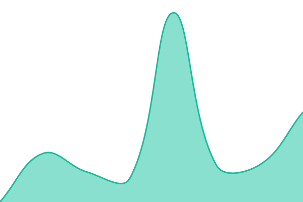
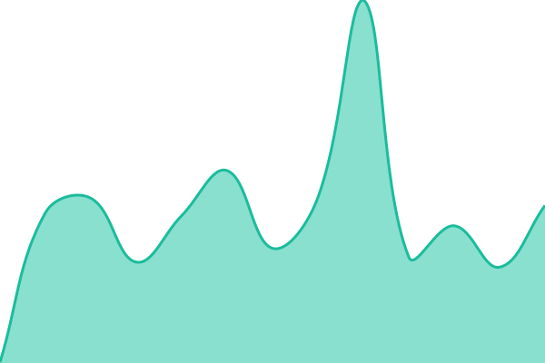
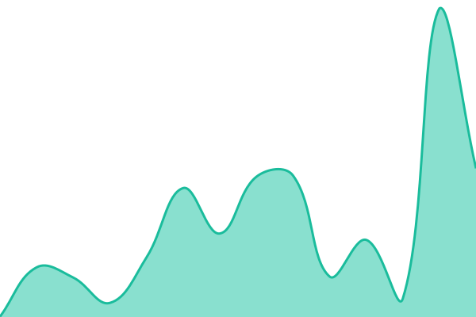
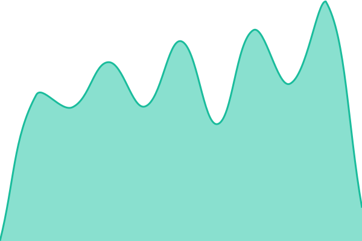

# Werewolf · Estado del servicio

Página de estado de Werewolf, generada con [Upptime](https://upptime.js.org) y publicada en GitHub Pages: https://paredesytecho.github.io/Werewolf-Status/

## Estado actual: <!--live status--> **Todos los servicios operativos**

<!--start: status pages-->
<!-- This summary is generated by Upptime (https://github.com/upptime/upptime) -->
<!-- Do not edit this manually, your changes will be overwritten -->
<!-- prettier-ignore -->
| Dirección | Estado | Historial | Tiempo de respuesta | Disponibilidad |
| --- | ------ | ------- | ------------- | ------ |
|  [Bot conectado a Discord](https://werewolfbot-c8v6.onrender.com/health) | Operativo | [bot-conectado-a-discord.yml](https://github.com/ParedesYTecho/Werewolf-Status/commits/HEAD/history/bot-conectado-a-discord.yml) | 

 263ms
     
 | 

<a href="https://ParedesYTecho.github.io/Werewolf-Status/history/bot-conectado-a-discord">100.00%</a>
    

|  [Servidor de Render](https://werewolfbot-c8v6.onrender.com) | Operativo | [servidor-de-render.yml](https://github.com/ParedesYTecho/Werewolf-Status/commits/HEAD/history/servidor-de-render.yml) | 

 241ms
     
 | 

<a href="https://ParedesYTecho.github.io/Werewolf-Status/history/servidor-de-render">100.00%</a>
    

|  [Web pública](https://werewolfdashboard.vercel.app/) | Operativo | [web-publica.yml](https://github.com/ParedesYTecho/Werewolf-Status/commits/HEAD/history/web-publica.yml) | 

 233ms
     
 | 

<a href="https://ParedesYTecho.github.io/Werewolf-Status/history/web-publica">100.00%</a>
    

|  [Base de datos](https://werewolfdashboard.vercel.app/api/estado) | Operativo | [base-de-datos.yml](https://github.com/ParedesYTecho/Werewolf-Status/commits/HEAD/history/base-de-datos.yml) | 

 663ms
     
 | 

<a href="https://ParedesYTecho.github.io/Werewolf-Status/history/base-de-datos">100.00%</a>
    

<!--end: status pages-->

## Mantenimiento

- Las comprobaciones, el historial, los gráficos y las incidencias se actualizan solos con GitHub Actions (comprobación cada 5 minutos en teoría; GitHub puede retrasar las ejecuciones programadas).
- La actualización automática de la plantilla de Upptime está desactivada a propósito: el `GITHUB_TOKEN` no puede modificar `.github/workflows`. Los workflows usan la versión fija `upptime/uptime-monitor@v1.46.5`.
- Dependabot abre cada semana un aviso (PR) si hay versiones nuevas de las acciones. No se fusiona solo.
